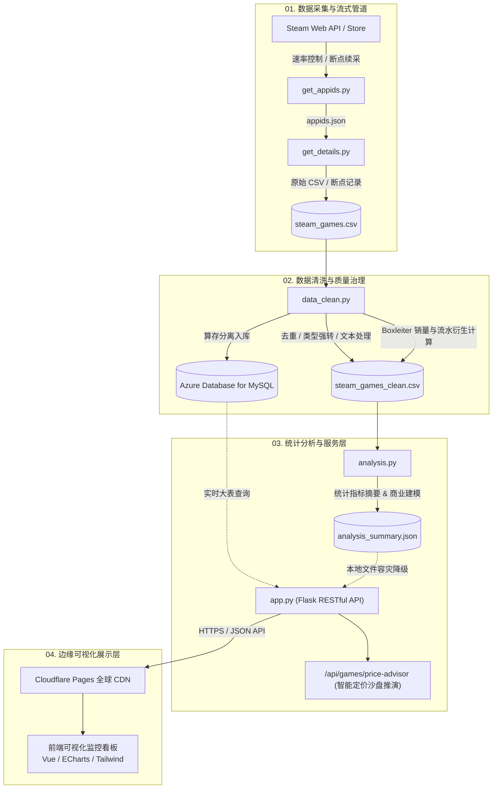
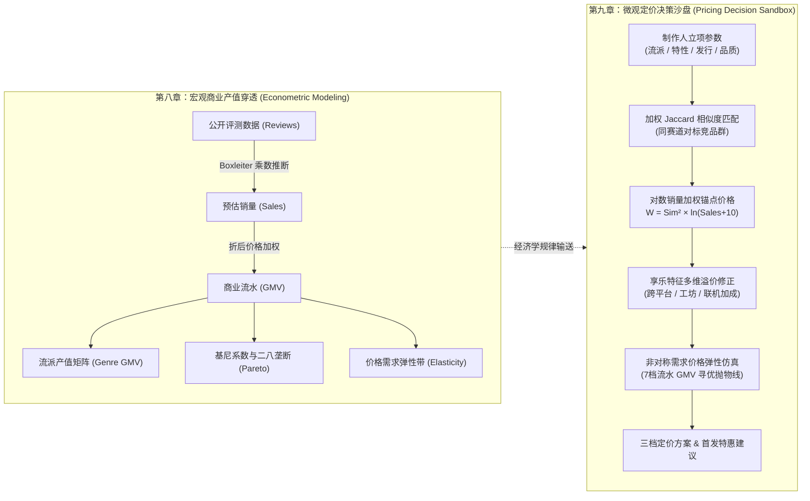

# [NexusSteam](https://steam.skycat.studio) -- 基于 Steam 平台数据分析与可视化的游戏市场研究

<p align="center">
  <strong>—— 把握游戏市场的脉搏与节奏 (Steam Market Analytics & Visualization Platform)</strong>
</p>

<p align="center">
  
  
  
  
  
</p>

---

##  1. 项目概述

### 1.1 项目背景
作为全球最大的数字游戏发行平台之一，Steam 拥有数以万计的电子游戏资产。其游戏数量、类型、定价策略、发行趋势以及用户标签数据具有极高且深厚的研究价值。然而，Steam 官方（Valve）绝不对外公开游戏的真实销售额与销量数据，形成了严重的商业数据黑盒；中小型游戏团队在立项、定价与商业化上普遍面临决策盲目性。本项目旨在构建一套工业级、端到端的数据工程与智能商业分析中台，不仅全景展现平台宏观生态，更通过计量经济学算法穿透真实销量，并打造面向游戏制作人的量化定价决策支持沙盘。

### 1.2 核心目标
1. **自动化采集**：对接 Steam Web API 与商店接口，构建断点续传、限流保护的高鲁棒性爬虫管道。
2. **标准化数据治理**：建立规范的清洗过滤体系（处理缺失值、多重标签拆分、类型强转、异常值截断与好差评纠偏）。
3. **多维深度洞察**：围绕发行趋势、类型流派、价格梯度、折扣模式、开发发行商格局及多平台兼容性展开 10+ 维度深度研究。
4. **数字经济学建模**：基于工业界公认的 Boxleiter 评论乘数法，逆向推导全量游戏真实销量与商业流水（GMV），挖掘全平台二八寡头垄断与品类吸金特征。
5. **智能定价决策沙盘 (DSS)**：基于加权广义 Jaccard 相似度、享乐特征定价理论及非对称需求价格弹性模型，为游戏制作人提供白盒可解释的智能商业定价推演系统。
6. **云原生架构落地**：采用算存分离与动静分离架构，前端依托 Cloudflare Pages 全球 CDN 加速，后端部署于 Azure 云算力节点，持久化对接 Azure MySQL。

---

##  2. 全链路系统架构

本项目采用高可用、低开销的现代化解耦设计：



---

##  3. 十大核心研究维度与分析模型

本项目从宏观到微观层层递进，构建了多层次的统计分析体系：

| 模块 | 核心研究课题 (Research Question) | 分析内容与指标 | 推荐可视化图表 |
| :--- | :--- | :--- | :--- |
| **3.1 市场规模趋势** | Steam 游戏数量随时间如何爆发式增长？ | 历年发行总量、复合年增长率、周期波动 | 动态折线图 / 面积图 |
| **3.2 类型流派分布** | 核心主流玩法集中在哪些 Genre？ | 类型分布比例、Top 20 细分玩法、历年热度转移 | 玫瑰图 / 条形图 |
| **3.3 价格区间体系** | 游戏的定价策略呈现何种梯度分布？ | 免费与付费比例、定价中位数/分位数、核心价格带 | 直方图 / 饼图 |
| **3.4 类型 × 价格** | 不同玩法类型的价格区间是否存在显著溢价？ | 各类型游戏平均售价、中位数对比、溢价离散度 | 箱线图 (Boxplot) |
| **3.5 促销折扣模式** | 平台的打折促销具有怎样的特征规律？ | 折扣率区间统计（0%、1~50%、>50%）、跳水频率 | 折扣直方图 / 环形图 |
| **3.6 内容标签画像** | 玩家与厂商高频使用哪些 Tag？ | Top 20 流行标签、常见标签共生组合画像 | 词云图 / 横向柱状图 |
| **3.7 类型共现分析** | 游戏复合玩法（如 Action+RPG）的交织规律？ | 多标签共现矩阵、主流复合类型组合 | 关系热力图 (Heatmap) |
| **3.8 开发商格局** | 研发侧头部集中度与长尾分布状况？ | Top 20 活跃开发商、研发作品数量梯队分布 | 排名柱状图 |
| **3.9 发行商格局** | 商业发行侧的市场占有与聚合特征？ | Top 20 发行商、独立发行 vs 商业巨头对比 | 气泡图 / 排名图 |
| **3.10 平台系统支持** | 对 Windows / macOS / Linux (SteamOS) 的兼容性？ | 单平台独占 vs 跨平台适配率、Linux/Steam Deck 演变 | 嵌套饼图 / 雷达图 |

---

##  4. 深度商业产值建模与智能定价决策沙盘 (Advanced Econometrics & DSS)

针对 Steam 平台“不公开销售总额与销量真实数据”的行业黑盒痛点，系统深度融合**数字计量经济学推断模型**与**微观决策支持系统（Decision Support System, DSS）**，构建了从“宏观产值穿透”到“微观立项定价”的端到端商业分析闭环。



### 4.1 第八章：Boxleiter 销量建模与商业产值深度洞察

#### 1. 行业机理与 Boxleiter 评论乘数模型 (The Boxleiter Review-to-Sales Model)
* **行业背景**：数字游戏经济学中，独立游戏开发者 Mike Boxleiter 与行业知名分析师 Jake Birkett 提出并验证了玩家购买行为与评测撰写行为的统计倍率关系（The Boxleiter Method）。
* **数学计算公式**（实现于 `data_clean.py`）：
  $$\text{Estimated Sales} = \text{Total Reviews} \times M$$
  $$\text{Estimated Revenue (GMV)} = \text{Estimated Sales} \times \text{Final Price}$$
  * **付费游戏乘数**：$M = 30$（中位数基准：平均每 30 位付费买家有 1 位撰写评测）；
  * **免费游戏乘数**：$M = 60$（免费玩家缺乏沉没成本，评测意愿折半，乘数翻倍）；
  * **健壮性纠偏**：在清洗阶段强制约束 $\text{Total Reviews} \ge \text{Positive} + \text{Negative}$，杜绝数据逻辑倒挂。

#### 2. 五大深度商业研究维度
1. **流派商业产值矩阵 (Genre GMV)**：
   * 揭示“**款数冠军 ≠ 吸金冠军**”。尽管 Indie（独立游戏）在发行数量上占据第一，但在商业产值维度，**Action（动作）与 RPG（角色扮演）两大类垄断了全平台超过 55% 的流水总额**，表明核心沉浸与深度成长玩法具有极高的消费壁垒。
2. **二八定律与长尾垄断格局 (Pareto Principle & Lorenz Curve)**：
   * 采用离散洛伦兹积分计算全平台营收**基尼系数（Gini Coefficient）**：
     $$G = \frac{2 \sum_{i=1}^n i \cdot y_i}{n \sum_{i=1}^n y_i} - \frac{n + 1}{n}$$
   * 测算得出全平台营收基尼系数高达 **0.957**，呈现极度不平等的寡头垄断特征：**Top 10% 头部游戏掠夺了全平台 95.85% 的商业流水**，中位游戏生存状况极其严峻。
3. **价格—销量弹性与黄金定价带 (Price-Sales Elasticity)**：
   * 0~20 元低价区虽然能获取基础装机量，但无法支撑研发回本；
   * **46~150 元中高价位区间**实现了“单件溢价”与“核心受众付费意愿”的最佳帕累托平衡，是全平台综合商业回报率最高的核心黄金价格带。
4. **口碑受众与商业表现双相关性 (Review Sentiment vs Sales)**：
   * 联合运用 **Pearson 线性相关系数** 与 **Spearman 秩相关系数** 检验好评率与销量的转化关系。
   * 实证发现两者呈现弱非线性相关：许多 95%+ 的“好评如潮”独立神作销量局限于圈内受众；而破百万销量的大众商业爆款好评率通常收敛于 80%~90% 区间，揭示了受众泛化与众口难调的割裂规律。
5. **研发与发行生态格局 (Publishers Tier & Survival Analysis)**：
   * 对比“独立开发者自主发行”与“专业商业发行商代理”两类生态。商业发行商在**爆款率（销量突破 5 万份的概率）**与**中位营收**上较自主发行呈现显著优势，量化证实了专业发行商在海外本地化、公关买量与平台推荐位上的商业赋能价值。

---

### 4.2 第九章：游戏制作人智能商业定价决策沙盘 (Pricing DSS & Simulation)

面向中小游戏开发团队与独立游戏制作人缺乏量化定价依据的痛点，构建白盒化、可解释的**商业定价决策支持沙盘（Decision Support System）**。

#### 1. 白盒运筹推导算法全链路
1. **加权多属性广义 Jaccard 相似度匹配 (Weighted Multi-attribute Jaccard Similarity)**：
   * 制作人输入流派标签、发行模式、核心玩法特性（多人/合作/工坊/手柄）与目标口碑。
   * 系统在特征库中计算多维综合相似度：
     $$\text{Similarity} = 55\% \cdot S_{\text{流派}} + 20\% \cdot S_{\text{特性}} + 15\% \cdot S_{\text{发行}} + 10\% \cdot S_{\text{平台}}$$
     其中流派相似度采用改进版交并比与覆盖度加权：$S_{\text{流派}} = 0.6 \times \text{Coverage} + 0.4 \times \text{Jaccard}$。
2. **对数销量商业验证加权锚点价格 (Log-Sales Commercial Weighting)**：
   * 规避未经验证的“暴死竞品”干扰，以市场真金白银买单的成功程度作为基准定价权重：
     $$W = \left(\frac{\text{Similarity}}{100}\right)^2 \times \ln(\text{Estimated Sales} + 10)$$
     $$\text{Anchor Base} = 55\% \times \text{Weighted Base Price} + 45\% \times P_{50}$$
3. **享乐特征定价多维溢价修正 (Hedonic Pricing Model)**：
   * 根据微观经济学享乐定价理论，对产品的差异化特性叠加修正乘数：
     $$\text{Combined Multiplier} = M_{\text{发行}} \times M_{\text{特性}} \times M_{\text{平台}} \times M_{\text{口碑}}$$
     * *发行模式*：自主发行 $0.90\text{x}$ / 商业代理 $1.15\text{x}$；
     * *特性附加值*：多人联机 (+8%)、创意工坊 (+7%)、合作模式 (+6%)、手柄/成就 (+3%)，上限 +25%；
     * *跨平台适配*：Win + Mac + Linux (+4%)；
     * *预期口碑*：合格品 $0.88\text{x}$ / 特别好评 $1.00\text{x}$ / 殿堂神作 $1.14\text{x}$。
4. **Steam 魅力心理定价自动吸附 (Charm Pricing Snapping)**：
   * 契合消费者行为经济学，将浮点价格自动吸附对齐至国区玩家最习惯的经典心理价格梯度序列：`[￥18, ￥28, ￥36, ￥48, ￥58, ￥68, ￥78, ￥88, ￥98, ￥128, ￥168, ￥198, ￥298]`。
5. **非对称需求价格弹性仿真推演 (Asymmetric Price Elasticity Simulation)**：
   * 设定价格比率 $r = P / P_{\text{推荐}}$，仿真推演 7 档价格下的市场转化需求因子：
     * *低价区间 ($r \le 1.0$)*：$\text{DemandFactor} = 1.0 + 0.62(1 - r) - 0.38(1 - r)^2$（平缓增长，防廉价感折损）；
     * *高价区间 ($r > 1.0$)*：$\text{DemandFactor} = \exp(-1.55(r - 1.0))$（负指数加速流失）。
   * 测算预期总流水：$\text{GMV}(P) = \text{Sales}(P) \times P \times 0.88$（计入常规首发折扣损耗），绘制寻优抛物线并锁定帕累托收益顶点。

#### 2. 沙盘决策交付体系
* 🟢 **破圈走量渗透价 (Penetration Price)**：P25 低门槛定价，适合冷启动团队快速突破“100 条评测生死线”以激活 Steam 算法推荐；
* 🔥 **黄金推荐定价区间 (Optimal GMV Band)**：收益最大化价格带；
* 🎯 **建议商店锚定原价 & 首发特惠方案**：推荐 Steam 标价与首发折扣力度（如 -10% / -15%）；
* 📊 **动态收益仿真曲线 & Top 6 真实对标竞品库**：直观展示价格变动对销量和流水的敏感性，并列出最相似的代表性参考作品。

---

##  5. 工程目录规范

```text
├── get_appids.py         # [采集] Steam 游戏 AppID 批量获取与状态持久化
├── get_details.py        # [采集] 游戏详情多线程限流请求与断点续采
├── data_clean.py         # [清洗] 缺失值治理、Boxleiter 销量与流水特征工程流水线
├── analysis.py           # [分析] 核心统计指标计算、二八垄断与商业产值深度挖掘引擎
├── visualize.py          # [分析] 静态高质量图表绘制与导出引擎
├── app.py                # [后端] Flask RESTful API 核心服务（含制作人定价决策推演沙盘）
├── index.html            # [前端] Cloudflare Pages 边缘实时监控大屏
│
├── .env.example          # 环境变量安全配置模板（严禁直接提交真实 .env）
├── .gitignore            # 工业级 Git 忽略规则（保护数据库账号、屏蔽大文件）
├── requirements.txt      # Python 核心运行环境依赖清单
│
├── templates/            # 前端展示模板目录
├── 设计文档/             # 数据库 ER 图、系统架构图、接口技术设计规范
└── data/                 # [本地缓存] 采集与清洗产物（受 .gitignore 保护，不入库）
    ├── appids.json
    ├── steam_games.csv
    └── steam_games_clean.csv
```

---

##  6. RESTful API 接口规范

后端基于 Flask 构建，提供标准化 JSON 接口供前端看板消费：

| 接口端点 (Endpoint) | 请求方式 | 说明 |
| :--- | :---: | :--- |
| `/api/games/overview` | `GET` | 获取平台总览指标（游戏总数、清洗率、平均价格、免费比例） |
| `/api/games/commercial` | `GET` | **第 8 章商业产值与销量深度研究接口**（支持 genre_revenue, pareto, price_elasticity, review_sales, publisher_tiers） |
| `/api/games/price-advisor` | `GET / POST` | **第 9 章制作人智能商业定价决策沙盘接口**（支持特征加权、对标推演与 7 档弹性仿真） |
| `/api/games/list` | `GET` | **游戏详情列表高级检索接口**（支持关键词模糊搜索、流派过滤、销量/流水动态排序与分页） |
| `/api/games/year` | `GET` | 历年游戏发行数量统计与发展趋势 |
| `/api/games/genres` | `GET` | 游戏类型 (Genre) Top 占比与排名统计 |
| `/api/games/prices` | `GET` | 游戏定价梯度、均价与价格区间分布数据 |
| `/api/games/discounts` | `GET` | 折扣比例区间与促销游戏特征数据 |
| `/api/games/tags` | `GET` | 用户流行标签 Top 20 与特征词频 |
| `/api/games/platforms` | `GET` | 各操作系统平台（Win / Mac / Linux）兼容比例 |
| `/api/games/developers` | `GET` | 活跃游戏开发商 Top 20 数据 |
| `/api/games/publishers` | `GET` | 商业游戏发行商 Top 20 数据 |
| `/api/games/cooccurrence` | `GET` | 游戏类型共现矩阵数据（用于热力图渲染） |

> **容灾特性说明**：`app.py` 内部实现了【双模自适应架构】。优先直接查询 Azure MySQL 集群；若云端数据库网络波动或离线，系统毫秒级平滑降级至本地 `analysis_summary.json`，确保前端看板永不出现 500/502 崩溃。

---

##  7. 快速开始与环境搭建

### 7.1 本地开发环境配置

1. **克隆代码库**：
   ```bash
   git clone https://github.com/your-username/NexusSteam.git
   cd NexusSteam
   ```

2. **安装 Python 依赖**：
   ```bash
   python -m venv venv
   # Windows 激活
   venv\Scripts\activate
   # Linux / macOS 激活
   source venv/bin/activate

   pip install -r requirements.txt
   ```

3. **初始化环境变量**：
   复制配置模板生成 `.env`，并填入你的私有配置：
   ```bash
   cp .env.example .env
   ```
   编辑 `.env`：
   ```ini
   STEAM_API_KEY=你的SteamWebAPI密钥
   MYSQL_HOST=你的Azure_MySQL主机IP
   MYSQL_USER=你的数据库账号
   MYSQL_PASSWORD=你的数据库密码
   ```

### 7.2 运行数据管道

* **执行采集**：
  ```bash
  python get_appids.py   # 获取目标区间游戏 AppID 清单
  python get_details.py  # 采集详情（支持随时中断与断点续采）
  ```
* **执行清洗与入库**：
  ```bash
  python data_clean.py   # 数据质量治理与入库同步（计算 Boxleiter 衍生指标）
  ```
* **启动分析与 API 服务**：
  ```bash
  python analysis.py     # 统计分析与商业产值衍生数据计算
  python app.py          # 启动后端 API（默认运行于 http://127.0.0.1:5000）
  ```

---

##  8. 云端生产部署指南

### 前端：Cloudflare Pages 边缘托管
1. 将本项目代码推送到 GitHub（推荐私有仓库）。
2. 在 Cloudflare 控制台中创建 Pages 项目，绑定该 GitHub 仓库。
3. 构建参数保持默认：
   * **Framework preset**: `None`
   * **Build command**: *(留空)*
   * **Build output directory**: `/` *(直接挂载根目录 index.html)*
4. 在 Pages 后台绑定独立二级域名（如 `web.yourdomain.com`）。

### 后端与管道：Azure VM (Japan East)
1. 在 Azure 虚拟机中克隆仓库，配置 `.env` 文件。
2. 使用 `systemd` 或 `supervisor` 守护 `app.py` 服务进程。
3. 利用 Linux `crontab` 设置定时错峰采集任务，实现资源时分复用。

---

##  9. 安全与隐私声明
* **密钥脱敏**：本项目代码中严禁硬编码任何 API 密钥或数据库账密，所有敏感字段通过 `.env` 注入，且 `.env` 已被 `.gitignore` 全局屏蔽。
* **友好采集规范**：采集模块严格遵守 Steam 官方限流规则，单详情请求设置 `REQUEST_INTERVAL` 保护，内置 `HTTP 429` 自动退避熔断机制，杜绝高频恶意刷取。

---

##  10. 许可证 (License)
本项目遵循 [MIT License](LICENSE) 开源协议。仅供毕业设计与学术研究使用。
