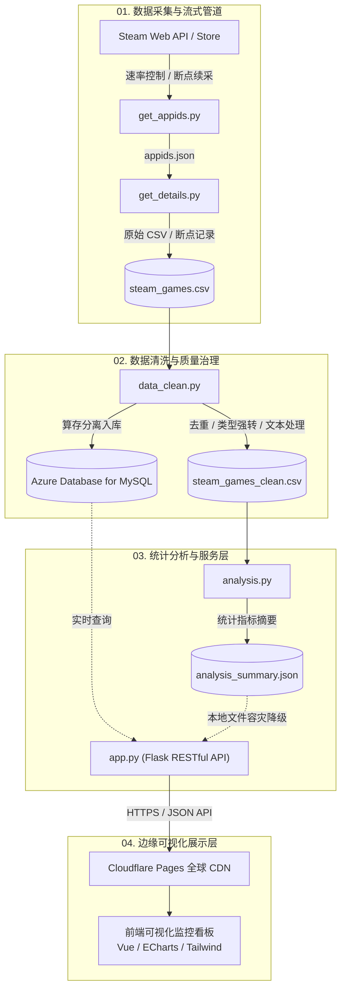

# [NexusSteam](https://steam.skycat.studio) -- 基于 Steam 平台数据分析与可视化的游戏市场研究

<p align="center">
  <strong>—— 把握游戏市场的脉搏与节奏 (Steam Market Analytics & Visualization Platform)</strong>
</p>

<p align="center">
  
  
  
  
  
</p>

---

##  1. 项目概述

### 1.1 项目背景
作为全球最大的数字游戏发行平台之一，Steam 拥有数以万计的电子游戏资产。其游戏数量、类型、定价策略、发行趋势以及用户标签数据具有极高且深厚的研究价值。本项目旨在构建一套工业级、端到端的数据分析与可视化中台，全方位洞察电子游戏市场的演变特征与商业模式。

### 1.2 核心目标
1. **自动化采集**：对接 Steam Web API 与商店接口，构建断点续传、限流保护的高鲁棒性爬虫管道。
2. **标准化数据治理**：建立规范的清洗过滤体系（处理缺失值、多重标签拆分、类型强转、异常值截断）。
3. **多维深度洞察**：围绕发行趋势、类型流派、价格梯度、折扣模式、开发发行商格局及多平台兼容性展开 10+ 维度深度研究。
4. **云原生架构落地**：采用算存分离与动静分离架构，前端依托 Cloudflare Pages 全球 CDN 加速，后端部署于 Azure 云算力节点，持久化对接 Azure MySQL。

---

##  2. 全链路系统架构

本项目采用高可用、低开销的现代化解耦设计：



---

##  3. 十大核心研究维度与分析模型

本项目从宏观到微观层层递进，构建了多层次的统计分析体系：

| 模块 | 核心研究课题 (Research Question) | 分析内容与指标 | 推荐可视化图表 |
| :--- | :--- | :--- | :--- |
| **3.1 市场规模趋势** | Steam 游戏数量随时间如何爆发式增长？ | 历年发行总量、复合年增长率、周期波动 | 动态折线图 / 面积图 |
| **3.2 类型流派分布** | 核心主流玩法集中在哪些 Genre？ | 类型分布比例、Top 20 细分玩法、历年热度转移 | 玫瑰图 / 条形图 |
| **3.3 价格区间体系** | 游戏的定价策略呈现何种梯度分布？ | 免费与付费比例、定价中位数/分位数、核心价格带 | 直方图 / 饼图 |
| **3.4 类型 × 价格** | 不同玩法类型的价格区间是否存在显著溢价？ | 各类型游戏平均售价、中位数对比、溢价离散度 | 箱线图 (Boxplot) |
| **3.5 促销折扣模式** | 平台的打折促销具有怎样的特征规律？ | 折扣率区间统计（0%、1~50%、>50%）、跳水频率 | 折扣直方图 / 环形图 |
| **3.6 内容标签画像** | 玩家与厂商高频使用哪些 Tag？ | Top 20 流行标签、常见标签共生组合画像 | 词云图 / 横向柱状图 |
| **3.7 类型共现分析** | 游戏复合玩法（如 Action+RPG）的交织规律？ | 多标签共现矩阵、主流复合类型组合 | 关系热力图 (Heatmap) |
| **3.8 开发商格局** | 研发侧头部集中度与长尾分布状况？ | Top 20 活跃开发商、研发作品数量梯队分布 | 排名柱状图 |
| **3.9 发行商格局** | 商业发行侧的市场占有与聚合特征？ | Top 20 发行商、独立发行 vs 商业巨头对比 | 气泡图 / 排名图 |
| **3.10 平台系统支持** | 对 Windows / macOS / Linux (SteamOS) 的兼容性？ | 单平台独占 vs 跨平台适配率、Linux/Steam Deck 演变 | 嵌套饼图 / 雷达图 |

---

##  4. 工程目录规范

```text
├── get_appids.py         # [采集] Steam 游戏 AppID 批量获取与状态持久化
├── get_details.py        # [采集] 游戏详情多线程限流请求与断点续采
├── data_clean.py         # [清洗] 缺失值处理、格式转换、规范化清洗流水线
├── analysis.py           # [分析] 核心统计指标计算与十维度市场数据分析
├── visualize.py          # [分析] 静态高质量图表绘制与导出引擎
├── app.py                # [后端] Flask RESTful API 核心服务（支持双模自适应容灾）
├── index.html            # [前端] Cloudflare Pages 边缘实时监控大屏
│
├── .env.example          # 环境变量安全配置模板（严禁直接提交真实 .env）
├── .gitignore            # 工业级 Git 忽略规则（保护数据库账号、屏蔽大文件）
├── requirements.txt      # Python 核心运行环境依赖清单
│
├── templates/            # 前端展示模板目录
├── 设计文档/             # 数据库 ER 图、系统架构图、接口技术设计规范
└── data/                 # [本地缓存] 采集与清洗产物（受 .gitignore 保护，不入库）
    ├── appids.json
    ├── steam_games.csv
    └── steam_games_clean.csv
```

---

##  5. RESTful API 接口规范

后端基于 Flask 构建，提供标准化 JSON 接口供前端看板消费：

| 接口端点 (Endpoint) | 请求方式 | 说明 |
| :--- | :---: | :--- |
| `/api/games/overview` | `GET` | 获取平台总览指标（游戏总数、清洗率、平均价格、免费比例） |
| `/api/games/year` | `GET` | 历年游戏发行数量统计与发展趋势 |
| `/api/games/genres` | `GET` | 游戏类型 (Genre) Top 占比与排名统计 |
| `/api/games/prices` | `GET` | 游戏定价梯度、均价与价格区间分布数据 |
| `/api/games/discounts` | `GET` | 折扣比例区间与促销游戏特征数据 |
| `/api/games/tags` | `GET` | 用户流行标签 Top 20 与特征词频 |
| `/api/games/platforms` | `GET` | 各操作系统平台（Win / Mac / Linux）兼容比例 |
| `/api/games/developers` | `GET` | 活跃游戏开发商 Top 20 数据 |
| `/api/games/publishers` | `GET` | 商业游戏发行商 Top 20 数据 |
| `/api/games/cooccurrence` | `GET` | 游戏类型共现矩阵数据（用于热力图渲染） |

> **容灾特性说明**：`app.py` 内部实现了【双模自适应架构】。优先直接查询 Azure MySQL 集群；若云端数据库网络波动或离线，系统毫秒级平滑降级至本地 `analysis_summary.json`，确保前端看板永不出现 500/502 崩溃。

---

##  6. 快速开始与环境搭建

### 6.1 本地开发环境配置

1. **克隆代码库**：
   ```bash
   git clone https://github.com/your-username/NexusSteam.git
   cd NexusSteam
   ```

2. **安装 Python 依赖**：
   ```bash
   python -m venv venv
   # Windows 激活
   venv\Scripts\activate
   # Linux / macOS 激活
   source venv/bin/activate

   pip install -r requirements.txt
   ```

3. **初始化环境变量**：
   复制配置模板生成 `.env`，并填入你的私有配置：
   ```bash
   cp .env.example .env
   ```
   编辑 `.env`：
   ```ini
   STEAM_API_KEY=你的SteamWebAPI密钥
   MYSQL_HOST=你的Azure_MySQL主机IP
   MYSQL_USER=你的数据库账号
   MYSQL_PASSWORD=你的数据库密码
   ```

### 6.2 运行数据管道

* **执行采集**：
  ```bash
  python get_appids.py   # 获取目标区间游戏 AppID 清单
  python get_details.py  # 采集详情（支持随时中断与断点续采）
  ```
* **执行清洗与入库**：
  ```bash
  python data_clean.py   # 数据质量治理与入库同步
  ```
* **启动分析与 API 服务**：
  ```bash
  python analysis.py     # 统计分析与衍生数据计算
  python app.py          # 启动后端 API（默认运行于 http://127.0.0.1:5000）
  ```

---

##  7. 云端生产部署指南

### 前端：Cloudflare Pages 边缘托管
1. 将本项目代码推送到 GitHub（推荐私有仓库）。
2. 在 Cloudflare 控制台中创建 Pages 项目，绑定该 GitHub 仓库。
3. 构建参数保持默认：
   * **Framework preset**: `None`
   * **Build command**: *(留空)*
   * **Build output directory**: `/` *(直接挂载根目录 index.html)*
4. 在 Pages 后台绑定独立二级域名（如 `web.yourdomain.com`）。

### 后端与管道：Azure VM (Japan East)
1. 在 Azure 虚拟机中克隆仓库，配置 `.env` 文件。
2. 使用 `systemd` 或 `supervisor` 守护 `app.py` 服务进程。
3. 利用 Linux `crontab` 设置定时错峰采集任务，实现资源时分复用。

---

##  8. 安全与隐私声明
* **密钥脱敏**：本项目代码中严禁硬编码任何 API 密钥或数据库账密，所有敏感字段通过 `.env` 注入，且 `.env` 已被 `.gitignore` 全局屏蔽。
* **友好采集规范**：采集模块严格遵守 Steam 官方限流规则，单详情请求设置 `REQUEST_INTERVAL` 保护，内置 `HTTP 429` 自动退避熔断机制，杜绝高频恶意刷取。

---

##  9. 许可证 (License)
本项目遵循 [MIT License](LICENSE) 开源协议。仅供毕业设计与学术研究使用。
